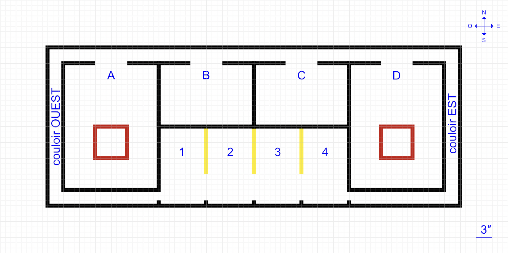

# INF1900 — Final Integration Project

**Team 107111 · Section 05 · Polytechnique Montréal**  
Jérémie Anglaret-Guirguis · Anis Benabdallah · Marc Abou-Saada · Yanis Ben Boudaoud

---

## What this project does

An ATmega324PA-based robot navigates an obstacle course autonomously. It leaves a parking spot, travels through two corridors separated by a room inspection zone, and parks itself in a designated stall — all without human input after the initial mode selection.

The robot has three operating modes, selected at boot via a button + LED sequence:

- **Instruction mode** — receives a bytecode program over UART, stores it in external EEPROM, and executes it. The interpreter reads opcodes that control direction, speed, wait times, and parking target.
- **Project mode** — runs the full autonomous mission described below.
- **Report mode** — reads inspection results from EEPROM and prints a compliance table over UART.

### Course map



The robot starts in one of the 4 parking stalls (chosen by the evaluator), exits south, then travels the perimeter clockwise or counter-clockwise depending on the `trd`/`trg` instruction received. At each stop it performs a specific inspection task before continuing.

---

## Hardware

| Component | Role |
|---|---|
| ATmega324PA | Main MCU |
| 5-sensor IR line array | Line following, intersection detection, object counting |
| GP2Y0A infrared rangefinder | Person detection in rooms |
| 24CXXX I²C EEPROM | Stores bytecode programs and inspection results |
| Dual DC motors (PWM) | Differential drive |
| Bicolor LED (PB0 / PB2) | Mode indicator |
| Piezo buzzer | Audio feedback |
| Push button (INT0) | Mode selection |

---

## Project structure

```
inf1900-107111/
├── lib/                        Static library (libstatique.a)
│   ├── robot.hpp / robot.cpp       Central class — all subsystems + state machine
│   ├── interpreter.hpp / .cpp      EEPROM bytecode interpreter
│   ├── motor.hpp / .cpp            PWM motor control
│   ├── lineSensor.hpp / .cpp       5-channel IR line sensor (ADC)
│   ├── distanceSensor.hpp / .cpp   IR rangefinder (ADC)
│   ├── timer.hpp / .cpp            Timer1 abstraction (CTC mode)
│   ├── LED.hpp / .cpp              Bicolor LED
│   ├── sound.hpp / .cpp            Buzzer
│   ├── button.hpp / .cpp           Button with interrupt debounce (INT0)
│   ├── UART.hpp / .cpp             Serial communication
│   ├── memoryReader.hpp / .cpp     Sequential EEPROM reader
│   ├── memoire_24.h / .cpp         Low-level I²C driver for 24CXXX
│   ├── can.h / .cpp                ADC driver
│   ├── eepromAdresses.hpp          Named EEPROM address constants
│   └── libstatique.hpp             Umbrella include for the whole library
│
└── app/                        Application entry point
    ├── main.cpp                    Mode selection loop (Timer1 CTC + INT0, SLEEP_MODE_IDLE)
    ├── Makefile                    Links main.cpp against libstatique.a
    └── programme.txt               Sample bytecode for instruction mode
```

---

## Architecture

All mission logic lives in the `Robot` class (`lib/robot.hpp / robot.cpp`). The `main()` function is intentionally minimal — it selects a mode, then calls one of three handlers:

```
main()
  ├── runInstruction()   ← receives + runs bytecode over UART
  ├── runProject()       ← autonomous mission (state machine below)
  └── runReport()       ← prints EEPROM inspection results over UART
```

`runProject()` initializes counters, reads the parking target from EEPROM, then enters a loop:

```cpp
while (true) {
    movementLogic(currentAction, previousAction); // execute current state
    switchLogic(currentAction, previousAction);   // evaluate transition
}
```

This clean separation means movement code never decides what comes next, and transition code never drives motors — each function has exactly one job.

---

## State machine

The autonomous mission is a 14-state FSM. States are defined as a private `enum class Action` inside `Robot`.

```
PARKING → LEAVE_PARKING → AFTER_PARKING
       → FIRST_TURN → FIRST_CORRIDOR
       → SECOND_TURN → SECOND_CORRIDOR ──┐
                              ↕ loop      │ roomCount 0–3
                  PEOPLE_ROOM / OBJECT_ROOM
                              │ roomCount == 4
       → THIRD_TURN → THIRD_CORRIDOR
       → FOURTH_TURN → ENTER_PARKING
       → COMPLETE_PARKING → END
```

### State descriptions

| State | What happens |
|---|---|
| `PARKING` | Robot reverses and pivots out of the parking stall in two steps. |
| `LEAVE_PARKING` | Maneuvers forward until the line sensor confirms center alignment on the main track. |
| `AFTER_PARKING` | Follows the right (or left, depending on `direction`) wall until it bumps the first intersection line. |
| `FIRST_TURN` | Executes `turnCorner()` — advances past the intersection, pivots 90°, then re-acquires the line. `confirmTurn()` validates the sensor reading before advancing. |
| `FIRST_CORRIDOR` | Follows the main path. While traveling, `lineSensor.findDamage()` counts damaged zones and logs them to EEPROM (`DAMAGE_EST` or `DAMAGE_WEST` depending on direction). |
| `SECOND_TURN` | Same corner logic as FIRST_TURN, plus a short forward nudge to position the robot at the mouth of the room corridor. |
| `SECOND_CORRIDOR` | Navigation hub of the mission. Routes to `PEOPLE_ROOM`, `OBJECT_ROOM`, or `THIRD_TURN` based on `roomCount` (0–4). Calls `findRoom3()` for rooms 1–3, which searches for the correct side-corridor entry. |
| `PEOPLE_ROOM` | Calls `distanceSensor.scanRoom()` to sweep an IR rangefinder and count persons. Result written to EEPROM (`PERSON_A` / `PERSON_D`). Then pivots back to the corridor line. |
| `OBJECT_ROOM` | Calls `detectObject()`, which drives the robot through the room while the line sensor counts reflective objects passing under it. Result written to EEPROM (`OBJECT_B` / `OBJECT_C`). |
| `THIRD_TURN` | Entered once all four rooms are visited (`roomCount == 4`). Same corner logic as previous turns. |
| `THIRD_CORRIDOR` | Mirrors FIRST_CORRIDOR on the return leg. Logs damage for the opposite corridor side. |
| `FOURTH_TURN` | Last corner before the parking area. |
| `ENTER_PARKING` | Follows the wall, counting parking stall lines until `parkingCount == parkingOperand` (target read from EEPROM at startup). |
| `COMPLETE_PARKING` | Drives into the stall at calibrated speeds, then backs up to align precisely within the painted boundary. |
| `END` | Plays a confirmation tone and halts. |

### Direction flag

A single `uint8_t direction` (0 = left, 1 = right) is set during EEPROM parsing and inverts every directional decision throughout the mission. This allows the same code to handle both possible course layouts without duplication.

### Room visit order

`roomCount` increments each time the robot exits a room. The mapping is:

| `roomCount` | State entered | EEPROM target |
|---|---|---|
| 0 | `PEOPLE_ROOM` | `PERSON_D` or `PERSON_A` |
| 1 | `OBJECT_ROOM` | `OBJECT_C` or `OBJECT_B` |
| 2 | `OBJECT_ROOM` | `OBJECT_B` or `OBJECT_C` |
| 3 | `PEOPLE_ROOM` | `PERSON_A` or `PERSON_D` |
| 4 | Exits loop → `THIRD_TURN` | — |

---

## How to build

A single `make` from `app/` builds everything:

```sh
cd inf1900-107111/app/
make
```

The `app/` Makefile calls the `lib/` Makefile automatically (target `lib:`) before linking. No separate step needed.

To flash the ATmega324PA over USBasp:

```sh
make install
```

**Toolchain:** avr-g++, avr-ar, avrdude. Tested on Ubuntu 24 and the Polytechnique lab image.

---

## Key design decisions

**Interrupt-driven idle loop in `main()`** — the mode selection loop uses `SLEEP_MODE_IDLE` and wakes only on Timer1 CTC (for LED blinking) and INT0 (button press). No busy-wait polling in the top-level loop.

**Separation of movement and transition logic** — `movementLogic()` drives hardware; `switchLogic()` decides state transitions. Neither function calls the other. This made debugging significantly easier: a motor issue pointed immediately to `movementLogic()`, a sequencing issue to `switchLogic()`.

**Calibrated speed constants** — `LEFT_SPEED` and `RIGHT_SPEED` are compile-time constants (both 110). Asymmetric corrections for turning and alignment are applied as offsets on top of these, keeping tuning centralized.

**EEPROM as the mission brief** — the parking stall target and course direction come from the bytecode written in instruction mode. `runProject()` reads them at startup via `readEepromOperands()`, so the same binary handles any valid course configuration without recompilation.